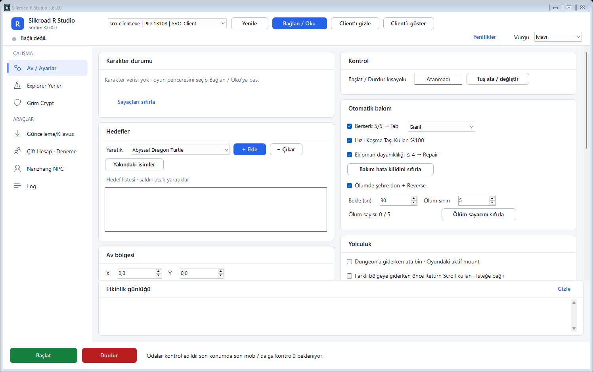

# Silkroad R Studio

New Era için C# / .NET Framework ile yazılmış bot. SQL veritabanı kullanmaz: ayarlar ve harita tabloları JSON, navigasyon ağı sıkıştırılmış ikili veridir.

> **Durum:** Test sürümü. Tüm dungeonların canlı gidiş ve bitiş testi tamamlanmadı.

## Arayüz

Açık renkli, kartlı bir masaüstü arayüzü. Tasarım kuralları [docs/design-system.md](docs/design-system.md) dosyasındadır.



## Kervan rotası

Kervan Rotası sayfasında Hotan - Jangan, Jangan - Hotan, Hotan - Donwhang ve Donwhang - Hotan düğmeleri vardır. Rota yalnızca yoldan hesaplanır (ticaret malı ışınlanamaz): düğme `walk,X,Y,Z` satırlarından oluşan bir script yazar ve karakteri hedef tüccar NPC'ye yürütür. Tüccar konumları programla gelmez; her şehirde NPC'ye oyunda tıklayıp "Seçili NPC'yi kaydet" demek yeterlidir. Eklentilerin incelenmesi: [docs/xplugins-analizi.md](docs/xplugins-analizi.md).

## İndirme ve güncelleme

Hazır EXE dosyası [Releases](https://github.com/RStudioForSilkroad/RStudioForSilkroad-Bot/releases/latest) sayfasındadır. `SilkroadRStudio.exe` dosyasını indirip açın.

Program yeni sürümleri kendisi kontrol eder, indirir, imzasını doğrular ve kendini günceller. Güncelleme adresi varsayılan olarak ayarlıdır; "Güncelleme/Kılavuz" sekmesinden değiştirilebilir.

## Klasörler

| Klasör | İçeriği |
|---|---|
| `src` | C# kaynak kodları: arayüz, otomasyon, navigasyon, güncelleme |
| `data` | Programa gömülen veriler: yol ağı, dungeon ve NPC haritaları, canavar adları, güncelleme genel anahtarı |
| `assets` | Simge, harita görseli, kullanım kılavuzu (PDF) |
| `tests` | Kontrol programları, test sonuçları, ekran görüntüleri |
| `tools` | Derleme, test ve yayın betikleri |
| `phbot` | phBot rota eklentisi |

## Derleme

Windows'ta .NET Framework C# derleyicisi (`csc.exe`) kurulu olmalıdır. Python gerekmez.

```powershell
powershell -NoProfile -ExecutionPolicy Bypass -File .\tools\build.ps1
```

Çıktı: `build\SilkroadRStudio.exe`

Derleme ayarları (gömülü kaynaklar, derleyici seçenekleri) `tools\common.ps1` içinde tek yerdedir; `build.ps1` ve `run-tests.ps1` bunu paylaşır. `src\` altına eklenen her `.cs` dosyası otomatik derlenir.

## Testler

```powershell
powershell -NoProfile -ExecutionPolicy Bypass -File .\tools\run-tests.ps1
```

Betik kontrol programını derleyip çalıştırır. Sonuç `tests\Test-Sonucu.txt` dosyasına ve örnek ekran görüntüleri `tests\Preview-*.png` dosyalarına yazılır; ikisi de üretilen dosyadır ve depoya girmez. Testler oyuna komut göndermez.

## Yeni sürüm yayınlama

1. **Bir kez (yapıldı):** `.\tools\1-anahtar-uret.ps1` imza anahtarını üretir. Özel anahtar `%USERPROFILE%\NewEraKeys\updates-private-key.xml` içinde kalır; **yedekleyin ve depoya asla koymayın**. Kaybedilirse mevcut kullanıcılara güncelleme gönderilemez. Betik anahtar zaten varsa üzerine yazmaz.
2. **Her sürümde:**
   ```powershell
   .\tools\2-yayin-hazirla.ps1 -Version 3.4.7.0 -Repo RStudioForSilkroad/RStudioForSilkroad-Bot
   ```
   Betik sürüm numarasını ayarlar, derler, imzalar ve `release\` klasörüne `SilkroadRStudio.exe` ile `manifest.json` dosyalarını koyar.
3. GitHub'da `v3.4.7.0` gibi bir etiketle yeni Release oluşturup bu iki dosyayı yükleyin.

Güncellemeler RSA imzasıyla doğrulanır. Doğrulama genel anahtarı `data\updates-public-key.xml` dosyasındadır ve programa gömülür. Varsayılan güncelleme adresi `UpdateTrust.DefaultManifestUrl` sabitindedir ([src/AutoUpdate.cs](src/AutoUpdate.cs)). Eski yazarın (`by-rikimaru`) sürümleri başka anahtarla imzalıdır; bu programda reddedilir ve eski adrese işaret eden kayıtlı ayarlar açılışta yeni adrese taşınır.

## phBot rota eklentisi

`phbot\SilkroadRStudioGrimRoutes.py` dosyasını phBot `Plugins` klasörüne koyun. Canlı rota üretimi phBot içinde oyuna giriş yapılmasını gerektirir.

## Bilinen durum

- Çevrimdışı rota taramasında 18 dungeon girişinin tamamı için rota bulunur.
- D11 ve D12 girişleri yol ağından kopuk küçük alanlardadır. Rota bu kısa boşluğu canlı yürüyüşle geçer; bu geçişin canlı testi yapılmadı.
- `data\road-mesh.bin.gz` dosyasının üretim kaynağı `tools\export-road-mesh.py` betiğidir. Yeniden üretmek için yerel oyun arşivi ve çözümlenmiş bölgeler gerekir. Hazır dosya normal derleme için yeterlidir.
- Depo kişisel hesap ayarlarını ve güncelleme imzalama özel anahtarını içermez.

## Dungeon sırası

Grim Crypt sekmesindeki "Çalıştırma sırası" paneli, seçtiğin Solo Trial dungeonları seçtiğin sırayla otomatik çalıştırır. Dungeon'u tabloda çift tıkla, **Ekle / Çıkar** düğmesiyle ya da haritada **Shift+tık** ile sıraya al; ▲ ▼ ile sırayı değiştir. Sıra haritada numara ve kesik çizgiyle görünür.

**Sırayı başlat:** bot girişe yürür, girer, dungeon'u bitirir, **Dungeon Exit NPC'si** ile çıkar (oyun verisindeki ışınlanma kaydı: Donwhang, 5000 altın) ve sıradakine geçer. Bitirilen dungeon "Girdim" olarak işaretlenir. Sıra bitince "Sıra bitince Return Scroll ile şehre dön" açıksa bir Return Scroll kullanır. Çıkış otomatik yapılamazsa bot loga yazar ve Dungeon Exit'e elle tıklamanı bekler.

## Yenilikler penceresi

Program güncellendikten sonra ilk açılışta o sürümün değişikliklerini gösterir. **Bir daha gösterme** kutusu işaretlenirse pencere bir daha çıkmaz. Notlar src\WhatsNew.cs içindedir; her sürümde buraya bir kayıt eklenir.

## Karakter durumu

Av / Ayarlar sekmesinin üstündeki panel HP (kırmızı), MP (mavi), EXP (yeşil) ve SP (sarı) çubuklarını canlı gösterir; oturum toplamı, dakikalık ve saatlik EXP/SP kazancı, seviyeye ve sonraki SP'ye kalan süreyi hesaplar. Hız son beş dakikanın ortalamasıdır (oturum daha kısaysa oturum ortalaması). Ölümde kaybedilen EXP kazanç sayılmaz. Değerler karakter nesnesinden okunur (HP/MP, seviye, EXP, SP alanları); seviye-EXP tablosu oyun verisinden alınmıştır (data\level-exp.json).

## Harita

Grim Crypt sekmesindeki **Dünya haritası**, oyunun kendi minimap karolarından birleştirilir (kaynak: [JellyBitz/xSROMap](https://github.com/JellyBitz/xSROMap), MIT). Koordinat eşlemesi kesindir: harita pikseli = oyun koordinatı / 4 + ofset. Yeniden üretmek için `tools\build-world-map.ps1`. Nanzhang bölgesinin karosu bu veri setinde yoktur.

## Lisans

Kod [MIT lisansı](LICENSE) altındadır. Oyuna ait harita, görsel ve isim verileri ilgili hak sahiplerine aittir; MIT lisansı bunları kapsamaz.
